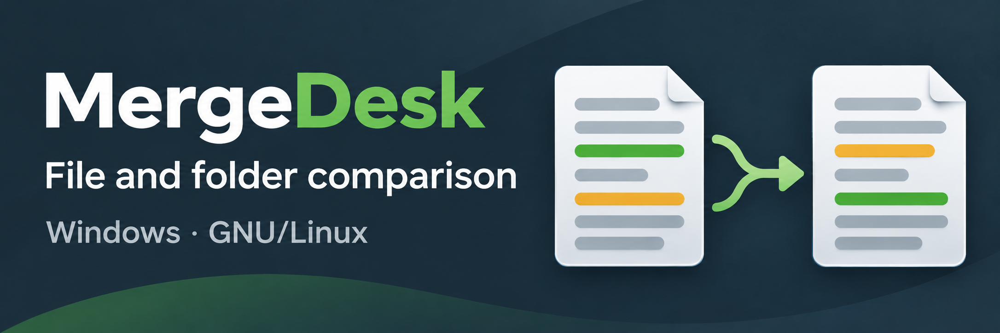
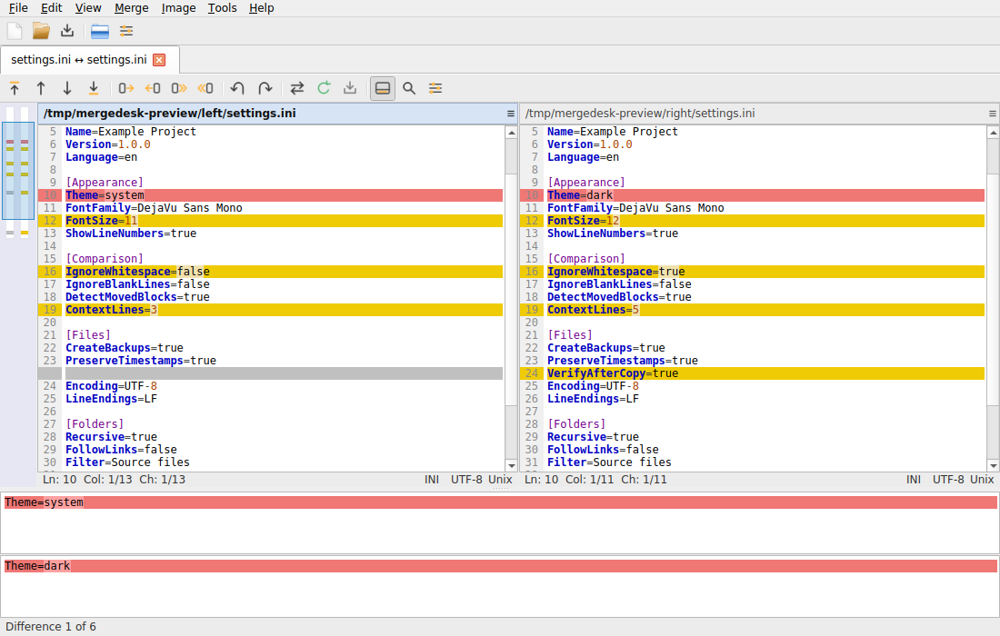
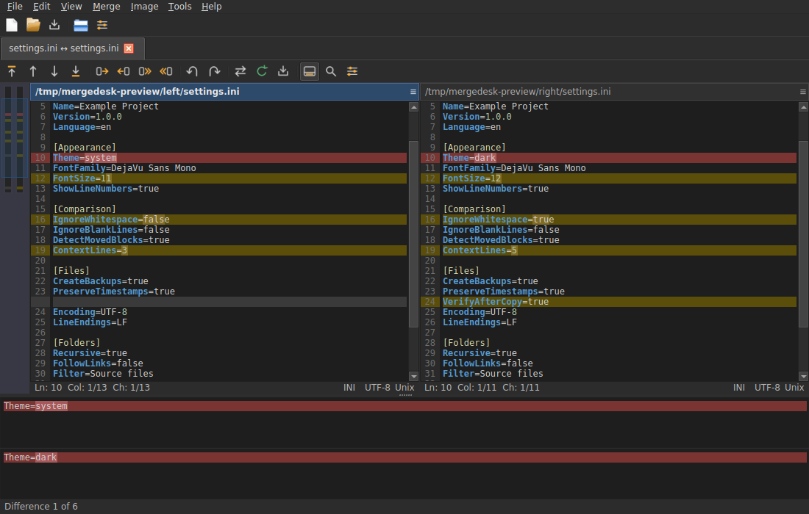

# MergeDesk 1.0.0

**A native Qt6 comparison and merging application for Windows and GNU/Linux, with a familiar WinMerge-style interface.**

Copyright (C) 2026 **davoda1** — MergeDesk original work and modifications. Licensed under **GPL-3.0-or-later**. Reused upstream code retains its original copyrights and licenses; see [THIRD-PARTY-NOTICES.md](THIRD-PARTY-NOTICES.md).

## What MergeDesk includes

- Editable two- and three-way text comparisons, aligned panes, character/word differences, moved-block detection, syntax highlighting, navigation, and undoable merges.
- Two- and three-way folder comparisons with background scans, filters, copying, Trash/Recycle Bin deletion, and multiple comparison methods.
- Editable CSV/TSV tables, image comparisons using the WinIMerge engine, binary/hex editing, and archive-as-folder comparisons.
- Rendered webpage comparison, with text, HTML, visible-area screenshot, and full-page snapshot comparison.
- Automatic three-way text merging with explicit conflict markers.
- WinMerge-compatible projects, settings interchange, unified patches, HTML reports, and folder CSV reports.
- Native extraction of modern Office/OpenDocument text; optional pdftotext and LibreOffice integration for additional formats.
- System/light/dark themes; English by default, with Hungarian, German, and French localization.
- Optional user-level file-manager integration for Windows Explorer, Dolphin, GNOME Files/Nautilus, Nemo, and Thunar.
- Atomic saves and copies, encoding-loss detection, retained backups, and no telemetry.

## Lineage and compatibility

The functional reference is **WinMerge 2.16.60**. The Qt application foundation is adapted from **LibreMerge**, and its vendored WinMerge engines are retained. MergeDesk adds Windows support, portable integration, additional workflows, safety improvements, and its own application identity. Neither upstream project endorses MergeDesk.

Read the [compatibility matrix](docs/COMPATIBILITY.md), [provenance](docs/PROVENANCE.md), and [manual](docs/MANUAL.md) for exact coverage and limitations. This project does not claim identical behavior for every Windows-only plugin or extension.

## Interface

Actual GNU/Linux Qt captures of MergeDesk 1.0.0 in light and dark mode. These
offscreen captures show the application widgets without an operating-system
window frame. Normal desktop sessions use the OS window decorations and native
file dialogs. Windows and GNU/Linux share the comparison layout.

| Light | Dark |
| --- | --- |
|  |  |

See the [validation guide](docs/VALIDATION.md) for reproducible checks and their
coverage, and the
[localization guide](docs/LOCALIZATION.md) for the four supported languages.

## Run

**Windows:** extract the entire portable ZIP and run `MergeDesk.exe` at its root. Keep its DLLs, plugins, and resources alongside it.

**GNU/Linux portable:** extract the TAR.GZ and run the `mergedesk` binary at its root. No launcher script is needed.

**AppImage:** make `MergeDesk-1.0.0-linux-x86_64.AppImage` executable and run it. Use `--appimage-extract` if your environment does not provide FUSE, then run `squashfs-root/AppRun`.

**DEB:** install the amd64 package with your package manager. `/usr/bin/mergedesk` is the actual executable. No init-system service is installed.

Settings are stored under the current user's application-data/configuration directory. Optional file-manager context-menu actions are installed only when requested from the Tools menu or explicit integration command. The DEB installs its application-menu entry and icons with the package; portable distributions add those only when requested.

## Build and verify

C++17, CMake 3.24+, Qt 6.11.3 or newer with Widgets/Concurrent/WebEngineWidgets/Svg/LinguistTools, POCO Foundation, ICU, Boost headers, libarchive, re2c, lemon, and GoogleTest are required. Release packages use the exact reviewed Qt SDK in [the runtime manifest](packaging/qt-runtime.json). The build pins Tree-sitter grammar downloads and validates their checksums.

```sh
cmake -S . -B build -G Ninja -DCMAKE_BUILD_TYPE=Release
cmake --build build --parallel 2
ctest --test-dir build --output-on-failure
./packaging/run_selftests.sh ./build/app/mergedesk
```

Set `CMAKE_PREFIX_PATH` to the reviewed SDK when it is installed outside the system search paths. Windows uses the supplied MSVC/vcpkg build configuration and Qt deployment tools. See the [build instructions](docs/BUILDING.md), [native build workflow](.github/workflows/build.yml), and [packaging tools](packaging) for reproducible builds. Package validation records identify the executable and enabled checks for each platform. Use records for the exact package being evaluated; a source build alone does not validate a relocated distribution. See [SECURITY.md](SECURITY.md) for dependency updates and security reporting.

## Optional converters

Modern Office and OpenDocument extraction is built in. PDF text requires `pdftotext`; legacy binary Office extraction requires LibreOffice. Their paths can be configured in Tools → Document Conversion Tools. Extracted source documents are never overwritten.

## License

MergeDesk is free software under GNU GPL version 3 or any later version. See [LICENSE](LICENSE). Upstream WinMerge, LibreMerge, Qt, WinIMerge, and other dependency notices are retained separately from MergeDesk's own `davoda1` attribution.
